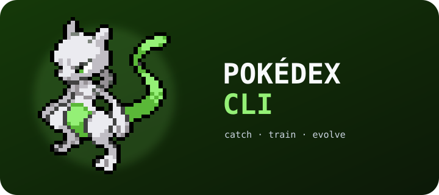
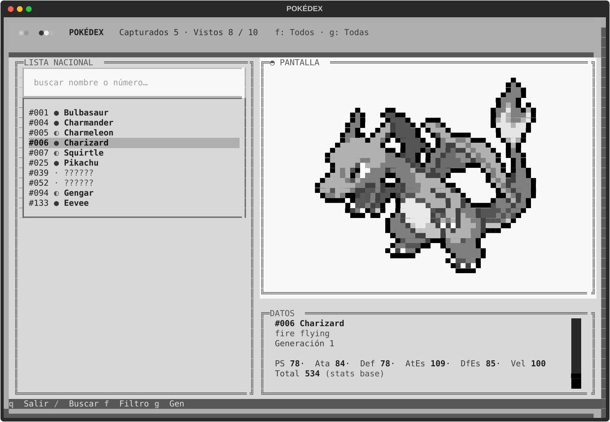

<p align="center">
  
</p>

<p align="center">
  
  
  
  
  
  
</p>

Pokédex en tu terminal. Cada terminal puede traer un Pokémon de
[Krabby](https://github.com/yannjor/krabby): tú decides si verlo, capturarlo,
entrenarlo y formar un equipo.

El estado vive en SQLite, los datos de especies se enriquecen con
[PokeAPI](https://pokeapi.co) y la experiencia visual se renderiza con Rich. 

## Inicio rápido

Requiere Python 3.11–3.13, Bash o Zsh, `rich`, `requests` y Krabby para los
sprites.

```bash
./install.sh
pokedex --help
```

El instalador crea una copia estable en el directorio XDG, un shim en
`~/bin/pokedex` y el completado de Bash y de Zsh. La activación del encuentro al
abrir una terminal está explicada en la
[guía de instalación](docs/installation.md).

## Inicio más rápido

Apaga el cerebro y dirige tu agente de código hacia [INSTALL.md](INSTALL.md).

## Comandos habituales

| Comando | Acción |
|---|---|
| `pokedex ver` | Ver el encuentro actual |
| `pokedex capturar [-b bola]` | Intentar una captura |
| `pokedex roca` | Aturdirlo: más captura, menos paciencia |
| `pokedex cebo` | Entretenerlo: más turnos, menos captura |
| `pokedex bolsas` | Consultar stock y actividad |
| `pokedex list` | Ver la colección |
| `pokedex list --legendarios` | Filtrar capturas legendarias y singulares |
| `pokedex search <nombre>` | Consultar una especie o forma |
| `pokedex vision <id>` | Abrir la ficha de una captura |
| `pokedex equipo [add\|remove] [id\|nombre]` | Gestionar el equipo o elegir en un selector |
| `pokedex combate [-e]` | Combatir con tu equipo contra el salvaje o un entrenador |
| `pokedex refresh` | Borrar y recargar desde PokeAPI los datos de las capturas |
| `pokedex demo` | Probar animaciones sin guardar estado |

## Zona Safari

Un encuentro no se resuelve solo a Pokeballs. Como en Rojo Fuego y Esmeralda,
puedes trabajarte al Pokémon salvaje antes de lanzar:

| Acción | Captura | Paciencia | Estado |
|---|---|---|---|
| `pokedex roca` | ×2 (hasta ×8) | −1 turno | se enfada: más fácil de acertar, huye antes |
| `pokedex cebo` | ÷2 (hasta ÷8) | +2 turnos (máx. 9) | se acerca a comer: se queda, cuesta acertarle |

Rocas y cebos son ilimitados: lo que gastas es un turno del encuentro, el mismo
recurso que consume una Pokeball fallida. Cada acción tiene su animación, y el
estado se cuenta con palabras, como en el juego: `pokedex ver` dice si está
enfadado o comiendo, sin cifras. Añade `--debug` si quieres los números. La
Masterball ignora el ánimo, porque nunca falla.

```console
$ pokedex roca
¡La roca ha dado en el blanco! Charizard está enfadado.

$ pokedex ver
Charizard — sin capturar · está enfadado
```

Para verlas sin gastar un encuentro: `pokedex demo -a roca` y `pokedex demo -a cebo`
(añade `-r escape` para ver cómo se larga).

## Combate

El Pokémon que espera también se puede combatir por turnos con tu equipo. Daño,
críticos, huida y EXP siguen las fórmulas de Gen 3, sobre la tabla de tipos
actual:

| Comando | Acción |
|---|---|
| `pokedex combate` | Combatir contra el salvaje o reanudar el combate en pausa |
| `pokedex combate -e` | Combatir contra un entrenador a la altura de tu equipo |
| `pokedex demo-combate [A] [B] [-n nivel]` | Exhibición entre capturas o especies, sin guardar nada |
| `pokedex movimientos <id> [--set m1,m2\|--auto]` | Ver o elegir los cuatro movimientos de una captura |

El combate ocupa la terminal, como en la GBA: sprites enfrentados, caja de
texto y menú. Se maneja con teclas sueltas: flechas o `hjkl` para moverte,
`Enter`, `Z` o espacio para elegir, `X` o `Esc` para volver y `1`-`4` como
atajo. `--velocidad` multiplica las pausas (`0`, instantáneo) y `--debug`
enseña el daño de cada golpe y la probabilidad de captura.

- **LUCHAR**: uno de sus cuatro movimientos, con PP, tipo y pista de eficacia.
  Sin PP le queda Forcejeo.
- **BOLSA**: una Pokeball del mismo stock que `pokedex capturar`.
- **POKÉMON**: otro de tu equipo (gasta el turno); tras un desmayo, el relevo.
- **HUIR**: más fácil si eres más rápido; al escapar, el salvaje también se va.

Para capturarlo, debilítalo sin noquearlo: con pocos PS la probabilidad casi se
triplica, y dormirlo o congelarlo la dobla (paralizarlo, quemarlo o
envenenarlo, ×1,5). Es un factor más sobre la captura de siempre: el ánimo de
la roca o el cebo sigue contando y cada bola fallida gasta paciencia, como
fuera del combate. Atrapas al individuo que has combatido; si lo noqueas,
ganas EXP pero se va.

Cada rival debilitado da EXP a quienes lo enfrentaron y siguen en pie: suben de
nivel, el moveset automático aprende movimientos nuevos y, al acabar, las
evoluciones se animan como en el hook. Cada combate empieza con los PS llenos.
Con `-e` el rival es un entrenador con especies de tu caché, sin legendarios,
singulares ni formas de combate: no se huye ni se captura, la EXP es ×1,5 y
cada victoria alarga tu racha, que una derrota corta.

El combate se guarda turno a turno: `Q` en el menú o `Ctrl+C` lo dejan en
pausa y `pokedex combate` lo reanuda. Al terminar queda un resumen con EXP,
niveles, captura y récord. Mientras dura un combate salvaje, el hook no saca
otro Pokémon, `pokedex ver` añade «en combate» y `capturar`, `roca` y `cebo` te
mandan a la BOLSA.

`pokedex demo-combate 4 106` enfrenta a tus capturas #4 y #106 con sus stats,
nivel y movimientos reales; con nombres de especie salen individuos fijos de
nivel 50, y `-n` fija el nivel de los dos. Sin argumentos lucha tu líder contra
una especie al azar de tu caché. No da EXP ni cuenta para el récord.

Cada captura lucha con un moveset automático que mejora al subir de nivel:
`pokedex movimientos 3 --set ascuas,arañazo` fija uno propio y `--auto` vuelve
al automático. Movimientos y learnsets salen de PokeAPI y se guardan en la BD;
sin datos, cada Pokémon lucha con movimientos de reserva de su tipo.

Sin terminal interactiva se juega en texto, con órdenes por stdin: `1`-`4`
movimiento, `c N` cambio, `b [bola]`, `h` huir, `a` IA y `q` pausa. Si stdin
se agota, o con `--auto`, decide la IA.

```console
$ echo 1 | pokedex combate
¡Un Pidgey salvaje apareció!
¡Adelante, Charmander!
Charmander Nv.50 · PS 104/104   contra   Pidgey salvaje Nv.5 · PS 20/20
Movimientos: [1] Ascuas 25/25 · [2] Arañazo 35/35 · [3] Gruñido 40/40
Órdenes: 1-4 movimiento · c N cambiar · b [bola] · h huir · a IA · q pausa
¿Qué debe hacer Charmander? › 1

— Turno 1 —
¡Charmander usó Ascuas!
¡Pidgey salvaje se debilitó!
¡Charmander ganó 45 puntos de experiencia!
¡Has ganado el combate!
```

## Pokédex interactiva

Ejecuta `pokedex` sin argumentos para abrir la colección en una vista de lista.
Puedes buscar por nombre o número, filtrar por estado y generación, y consultar
los datos de cada Pokémon capturado. Pulsa `l` para mostrar solo legendarios y
singulares (también pendientes), y `Esc` para limpiar los filtros. Con `c`
combates sin salir de la Pokédex: reanudar el combate en pausa, el Pokémon
salvaje, un entrenador o una exhibición. La ficha de cada captura muestra sus
movimientos.

<p align="center">
  
</p>

## Documentación

La [documentación del proyecto](docs/README.md) está organizada por propósito:

- empezar y operar: [instalación](docs/installation.md) y
  [backup/recuperación](docs/operations.md);
- desarrollar: [testing](docs/testing.md), [gates](docs/change-gates.md) y
  [estándares](docs/engineering-standards.md);
- entender: [arquitectura](docs/architecture.md),
  [modelo de datos](docs/data-model.md) e [infraestructura](docs/infrastructure.md).
